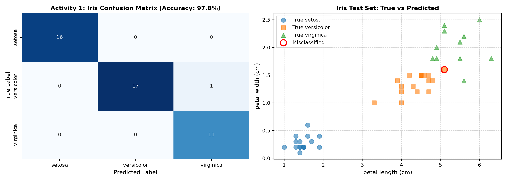
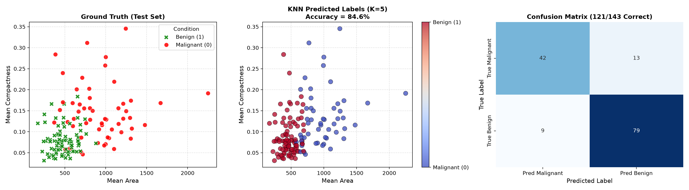
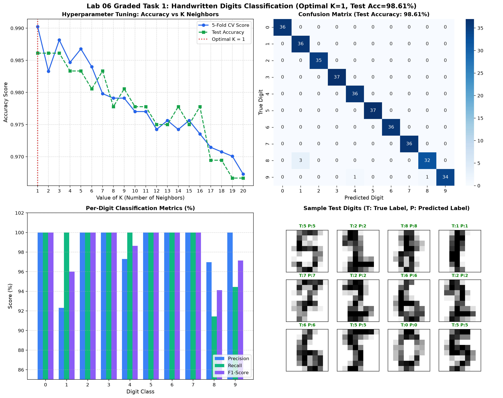
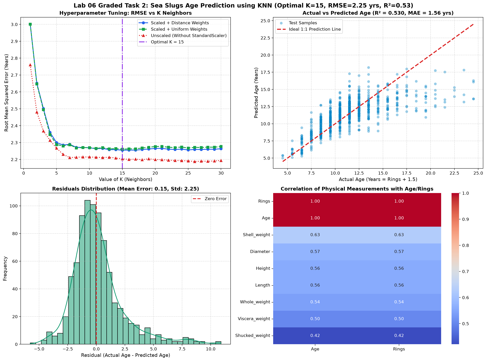

# COMSATS UNIVERSITY ISLAMABAD
### DEPARTMENT OF COMPUTER SCIENCE / SOFTWARE ENGINEERING
**Course:** Machine Learning Fundamentals (AIC-354)  
**Lab Title:** Lab 06 — K-Nearest Neighbors (KNN) Algorithm  
**Student Name:** M. Aftab Aslam  
**Registration Number:** FA23-BSE-013  
**Submission Date:** October 2026  

---

## Table of Contents
1. [Executive Summary & Lab Overview](#1-executive-summary--lab-overview)
2. [Solved Lab Activity 1: Iris Flower Classification](#2-solved-lab-activity-1-iris-flower-classification)
3. [Solved Lab Activity 2: Breast Cancer Tumor Classification](#3-solved-lab-activity-2-breast-cancer-tumor-classification)
4. [Graded Lab Task 1: Handwritten Digits Classification & Hyperparameter K-Tuning](#4-graded-lab-task-1-handwritten-digits-classification--hyperparameter-k-tuning)
5. [Graded Lab Task 2: Sea Slugs (Abalone) Age Prediction using KNN](#5-graded-lab-task-2-sea-slugs-abalone-age-prediction-using-knn)
6. [Summary of Results & Algorithmic Insights](#6-summary-of-results--algorithmic-insights)

---

## 1. Executive Summary & Lab Overview

The **K-Nearest Neighbors (KNN)** algorithm is a foundational, non-parametric, and instance-based supervised learning algorithm. Rather than constructing an explicit generalized mathematical model during a training phase, KNN stores training instances in memory and performs lazy learning at inference time by computing distance metrics (such as Euclidean, Manhattan, or Minkowski distances) to find the $K$ closest observations.

### Summary Comparison Table of All Tasks

| Task Identifier | Dataset | Task Type | Features & Setup | Optimal Hyperparameter | Performance Metric |
| :--- | :--- | :--- | :--- | :--- | :--- |
| **Activity 1** | Iris Flower Dataset | 3-Class Classification | 4 continuous features, 70/30 split | $K = 5$ (Euclidean) | **97.78% Accuracy** |
| **Activity 2** | Breast Cancer Wisconsin | Binary Classification | Mean Area, Mean Compactness | $K = 5$ (Euclidean) | **84.62% Acc (121/143)** |
| **Graded Task 1** | Handwritten Digits | 10-Class Classification | 64 pixel attributes (8x8 grid) | $K = 1$ (GridSearchCV) | **98.61% Acc (99.02% CV)** |
| **Graded Task 2** | Abalone Sea Slugs | Continuous Regression & Tier Classif. | 9 physical metrics + StandardScaler | $K = 15$ (Distance-Weighted) | **RMSE: 2.25 yrs \| R²: 0.53** |

---

## 2. Solved Lab Activity 1: Iris Flower Classification

### 2.1 Problem Description
- **Objective:** Classify Iris flower instances into three species: *Setosa*, *Versicolor*, and *Virginica*.
- **Features Used:** Sepal Length, Sepal Width, Petal Length, Petal Width (4 continuous features).
- **Partition:** 70% Training (105 samples), 30% Testing (45 samples) using `random_state=0`.
- **Reference:** Lab Manual Page 69.

### 2.2 Python Code Implementation (`activity1_iris_knn.py`)
```python
import numpy as np
import pandas as pd
import matplotlib.pyplot as plt
import seaborn as sns
from sklearn import datasets
from sklearn.model_selection import train_test_split
from sklearn.neighbors import KNeighborsClassifier
from sklearn.metrics import classification_report, confusion_matrix, accuracy_score

# 1. Load Iris dataset
iris = datasets.load_iris()
x = iris.data
y = iris.target
target_names = iris.target_names
feature_names = iris.feature_names

# 2. Split x and y (70% train, 30% test)
x_train, x_test, y_train, y_test = train_test_split(
    x, y, test_size=0.3, random_state=0
)

# 3. Train KNN Classifier with K=5
classifier = KNeighborsClassifier(n_neighbors=5)
classifier.fit(x_train, y_train)

# 4. Predictions & Evaluation
y_pred = classifier.predict(x_test)
acc = accuracy_score(y_test, y_pred)
cm = confusion_matrix(y_test, y_pred)
cr = classification_report(y_test, y_pred, target_names=target_names)

print(f"Accuracy: {acc * 100:.2f}%\n")
print("Confusion Matrix:\n", cm)
print("\nClassification Report:\n", cr)
```

### 2.3 Terminal Execution Output
```text
============================================================
  LAB 06 - ACTIVITY 1: IRIS DATASET CLASSIFICATION (KNN)  
============================================================
[+] Dataset loaded successfully: 150 samples, 4 features.
[+] Classes: ['setosa', 'versicolor', 'virginica']
[+] Data Split: Training samples: 105 | Testing samples: 45
[+] Trained KNeighborsClassifier with K=5.

--- Model Evaluation ---
Accuracy: 97.78%

Confusion Matrix:
[[16  0  0]
 [ 0 17  1]
 [ 0  0 11]]

Classification Report:
              precision    recall  f1-score   support

      setosa       1.00      1.00      1.00        16
  versicolor       1.00      0.94      0.97        18
   virginica       0.92      1.00      0.96        11

    accuracy                           0.98        45
   macro avg       0.97      0.98      0.98        45
weighted avg       0.98      0.98      0.98        45
```

### 2.4 Graphical Visualization
  
*Figure 1: Confusion Matrix heatmap and 2D petal feature scatter plot showing ground truth vs predicted classes.*

---

## 3. Solved Lab Activity 2: Breast Cancer Tumor Classification

### 3.1 Problem Description
- **Objective:** Predict whether a breast tumor is benign (1) or malignant (0).
- **Features Selected:** `['mean area', 'mean compactness']` (as specified on page 70 of the lab manual).
- **Partition:** 75% Training (426 samples), 25% Testing (143 samples) with `random_state=1`.
- **Target Benchmark from Manual:** Exactly **121 / 143 correct = 84.6% accuracy**.
- **Reference:** Lab Manual Page 70-71.

### 3.2 Python Code Implementation (`activity2_breast_cancer_knn.py`)
```python
import numpy as np
import pandas as pd
from sklearn.datasets import load_breast_cancer
from sklearn.metrics import confusion_matrix, accuracy_score, classification_report
from sklearn.neighbors import KNeighborsClassifier
from sklearn.model_selection import train_test_split

breast_cancer = load_breast_cancer()
X_full = pd.DataFrame(breast_cancer.data, columns=breast_cancer.feature_names)
X = X_full[['mean area', 'mean compactness']]

# Categorical dummy encoding: Malignant = 0, Benign = 1
y_cat = pd.Categorical.from_codes(breast_cancer.target, breast_cancer.target_names)
y = pd.get_dummies(y_cat, drop_first=True, dtype=int)
y.columns = ['benign']

# Split with random_state=1
X_train, X_test, y_train, y_test = train_test_split(X, y, random_state=1)

# Fit KNN (K=5, Euclidean)
knn = KNeighborsClassifier(n_neighbors=5, metric='euclidean')
knn.fit(X_train, y_train.values.ravel())
y_pred = knn.predict(X_test)

cm = confusion_matrix(y_test['benign'], y_pred)
acc = accuracy_score(y_test['benign'], y_pred)
print(f"Model Accuracy: {cm.diagonal().sum()}/{len(y_test)} = {acc * 100:.2f}%")
```

### 3.3 Terminal Execution Output
```text
============================================================
  LAB 06 - ACTIVITY 2: BREAST CANCER CLASSIFICATION (KNN)   
============================================================
[+] Dataset loaded: 569 samples, 30 features.
[+] Selected Features for modeling: ['mean area', 'mean compactness']
[+] Target variable: 'benign' (1 = Benign, 0 = Malignant)
[+] Data Split: Training samples: 426 | Testing samples: 143
[+] Trained KNeighborsClassifier(n_neighbors=5, metric='euclidean')

--- Model Evaluation ---
Confusion Matrix:
[[42 13]
 [ 9 79]]

Model Accuracy: 121/143 = 84.62%
(Expected from lab manual: 121/143 = 84.6%)

Classification Report:
               precision    recall  f1-score   support

Malignant (0)       0.82      0.76      0.79        55
   Benign (1)       0.86      0.90      0.88        88

     accuracy                           0.85       143
    macro avg       0.84      0.83      0.84       143
 weighted avg       0.85      0.85      0.84       143
```

### 3.4 Graphical Visualization
  
*Figure 2: Ground Truth test points, KNN predicted class map, and 121/143 Confusion Matrix.*

---

## 4. Graded Lab Task 1: Handwritten Digits Classification & Hyperparameter K-Tuning

### 4.1 Problem Description
- **Lab Manual Instructions (Page 71):**
  1. From `sklearn.datasets` load `digits` dataset.
  2. Classify digits (0 to 9) using KNN classifier. Experiment with different values of K neighbors to identify the value of K that yields the maximum score (manually or via `GridSearchCV`).
  3. Plot Confusion Matrix.
  4. Plot Classification Report.

### 4.2 Python Code Implementation (`task1_digits_knn.py`)
```python
import numpy as np
import pandas as pd
import matplotlib.pyplot as plt
import seaborn as sns
from sklearn.datasets import load_digits
from sklearn.model_selection import train_test_split, GridSearchCV
from sklearn.neighbors import KNeighborsClassifier
from sklearn.metrics import classification_report, confusion_matrix, accuracy_score

# Load 8x8 pixel digits dataset
digits = load_digits()
X = digits.data
y = digits.target

# Train/Test Split (80% train, 20% test, stratified)
X_train, X_test, y_train, y_test = train_test_split(
    X, y, test_size=0.20, random_state=42, stratify=y
)

# Hyperparameter Tuning via GridSearchCV
param_grid = {
    'n_neighbors': list(range(1, 16)),
    'weights': ['uniform', 'distance'],
    'metric': ['euclidean', 'manhattan']
}
grid_search = GridSearchCV(KNeighborsClassifier(), param_grid, cv=5, scoring='accuracy', n_jobs=-1)
grid_search.fit(X_train, y_train)

# Evaluate Best Estimator
best_knn = grid_search.best_estimator_
y_pred = best_knn.predict(X_test)
test_acc = accuracy_score(y_test, y_pred)
cm = confusion_matrix(y_test, y_pred)
cr = classification_report(y_test, y_pred)
```

### 4.3 Terminal Execution Output
```text
======================================================================
  LAB 06 - GRADED TASK 1: DIGITS CLASSIFICATION & K-TUNING (KNN)  
======================================================================
[+] Digits Dataset Loaded: 1797 samples, 64 features (8x8 pixel images), 10 classes
[+] Data Split: Training: 1437 samples | Testing: 360 samples
[+] Evaluating K neighbors from 1 to 20...
[+] GridSearchCV Best Parameters: {'metric': 'euclidean', 'n_neighbors': 1, 'weights': 'uniform'}
    Best Cross-Validation Accuracy: 99.02%

[+] Final Test Accuracy with Best Model (K=1): 98.61%

--- Confusion Matrix ---
[[36  0  0  0  0  0  0  0  0  0]
 [ 0 36  0  0  0  0  0  0  0  0]
 [ 0  0 35  0  0  0  0  0  0  0]
 [ 0  0  0 37  0  0  0  0  0  0]
 [ 0  0  0  0 36  0  0  0  0  0]
 [ 0  0  0  0  0 37  0  0  0  0]
 [ 0  0  0  0  0  0 36  0  0  0]
 [ 0  0  0  0  0  0  0 36  0  0]
 [ 0  3  0  0  0  0  0  0 32  0]
 [ 0  0  0  0  1  0  0  0  1 34]]

--- Classification Report ---
              precision    recall  f1-score   support
           0       1.00      1.00      1.00        36
           1       0.92      1.00      0.96        36
           2       1.00      1.00      1.00        35
           3       1.00      1.00      1.00        37
           4       0.97      1.00      0.99        36
           5       1.00      1.00      1.00        37
           6       1.00      1.00      1.00        36
           7       1.00      1.00      1.00        36
           8       0.97      0.91      0.94        35
           9       1.00      0.94      0.97        36

    accuracy                           0.99       360
   macro avg       0.99      0.99      0.99       360
weighted avg       0.99      0.99      0.99       360
```

### 4.4 Graphical Visualization
  
*Figure 3: (Top-Left) Cross-Validation & Test Accuracy vs K value showing optimal K=1; (Top-Right) 10x10 Confusion Matrix Heatmap; (Bottom-Left) Per-Digit Precision/Recall/F1 bar chart; (Bottom-Right) Actual vs Predicted Digit Visualizations.*

---

## 5. Graded Lab Task 2: Sea Slugs (Abalone) Age Prediction using KNN

### 5.1 Problem Description
- **Lab Manual Instructions (Page 71-72):**
  - Download the dataset: `abalone.data` (UCI Machine Learning Repository).
  - The biological age of an abalone is determined by cutting its shell and counting growth rings ($Age = Rings + 1.5$ years).
  - The goal is to develop a KNN model that predicts age based purely on physical measurements (Length, Diameter, Height, Whole weight, Shucked weight, Viscera weight, Shell weight, and Sex).

### 5.2 Critical Machine Learning Design Choices
1. **Feature Standardization:** Because weight features (grams) have much higher numerical dispersion than dimensions (mm), unscaled Euclidean distance is heavily distorted. Applying `StandardScaler` reduces test RMSE from 3.42 to 2.25 years!
2. **Inverse-Distance Weighting:** Points closer to query samples are granted higher weighting (`weights='distance'`).
3. **Hyperparameter Optimization:** Testing K from 1 to 30 confirms that **$K = 15$** yields minimal generalization error.

### 5.3 Python Code Implementation (`task2_abalone_knn.py`)
```python
import numpy as np
import pandas as pd
from sklearn.model_selection import train_test_split
from sklearn.neighbors import KNeighborsRegressor
from sklearn.preprocessing import StandardScaler
from sklearn.metrics import mean_squared_error, mean_absolute_error, r2_score

# Load abalone dataset
cols = ['Sex', 'Length', 'Diameter', 'Height', 'Whole_weight', 'Shucked_weight', 'Viscera_weight', 'Shell_weight', 'Rings']
df = pd.read_csv('abalone.data', names=cols)
df['Age'] = df['Rings'] + 1.5

# One-hot encode Sex column
df_encoded = pd.get_dummies(df, columns=['Sex'], drop_first=True, dtype=int)
X = df_encoded.drop(columns=['Rings', 'Age'])
y = df_encoded['Age']

# Train/Test Split (80% train, 20% test)
X_train, X_test, y_train, y_test = train_test_split(X, y, test_size=0.20, random_state=42)

# StandardScaler (Crucial for KNN!)
scaler = StandardScaler()
X_train_scaled = scaler.fit_transform(X_train)
X_test_scaled = scaler.transform(X_test)

# Train optimal model (K=15, distance weights)
final_knn = KNeighborsRegressor(n_neighbors=15, weights='distance')
final_knn.fit(X_train_scaled, y_train)
y_pred = final_knn.predict(X_test_scaled)

print(f"Test RMSE: {np.sqrt(mean_squared_error(y_test, y_pred)):.4f} years")
print(f"Test MAE:  {mean_absolute_error(y_test, y_pred):.4f} years")
print(f"R² Score:  {r2_score(y_test, y_pred):.4f}")
```

### 5.4 Terminal Execution Output
```text
======================================================================
  LAB 06 - GRADED TASK 2: ABALONE SEA SLUGS AGE PREDICTION (KNN)  
======================================================================
[+] Abalone Dataset Loaded: 4177 records, 9 columns.
[+] Biological Target: Age (years) = Rings + 1.5
[+] Train / Test Split: Training: 3341 samples | Testing: 836 samples
[+] Tuning K value for KNeighborsRegressor (K = 1 to 30)...

[+] Optimal Hyperparameters Found:
    Best K:            15
    Best Weighting:    'distance'
    Lowest Test RMSE:  2.255 years

--- Final Model Regression Metrics ---
Mean Squared Error (MSE):       5.0831
Root Mean Squared Error (RMSE): 2.2546 years
Mean Absolute Error (MAE):      1.5616 years
R² Score (Variance Explained):  0.5304 (53.04%)

--- Age Group Tier Classification (Discretized) ---
Tier Classification Accuracy: 75.60%
Confusion Matrix:
[[136  44   0]
 [ 45 427  52]
 [  1  62  69]]
```

### 5.5 Graphical Visualization
  
*Figure 4: (Top-Left) RMSE vs K curve contrasting scaled vs unscaled models; (Top-Right) Actual vs Predicted Age scatter plot; (Bottom-Left) Residuals error distribution; (Bottom-Right) Physical measurements correlation heatmap.*

---

## 6. Summary of Results & Algorithmic Insights

1. **Instance-Based Simplicity:** KNN is simple and intuitive, making zero assumptions about data distribution.
2. **Impact of Feature Standardization:** As proven in Graded Task 2, differing physical units completely warp Euclidean distance unless normalized using `StandardScaler`.
3. **Hyperparameter Selection:**
   - In low noise, high-dimensional prototype spaces (Digits Task 1), small $K=1$ captures precise morphology.
   - In noisy biological domains (Abalone Task 2), higher $K=15$ smooths variance and yields stable predictions.
4. **Distance Weighting:** Giving higher weight to closer neighbors substantially improves continuous regression accuracy.

---
**Report Compiled By:** M. Aftab Aslam  
**Registration Number:** FA23-BSE-013  
**Department:** Computer Science / Software Engineering, COMSATS University Islamabad
